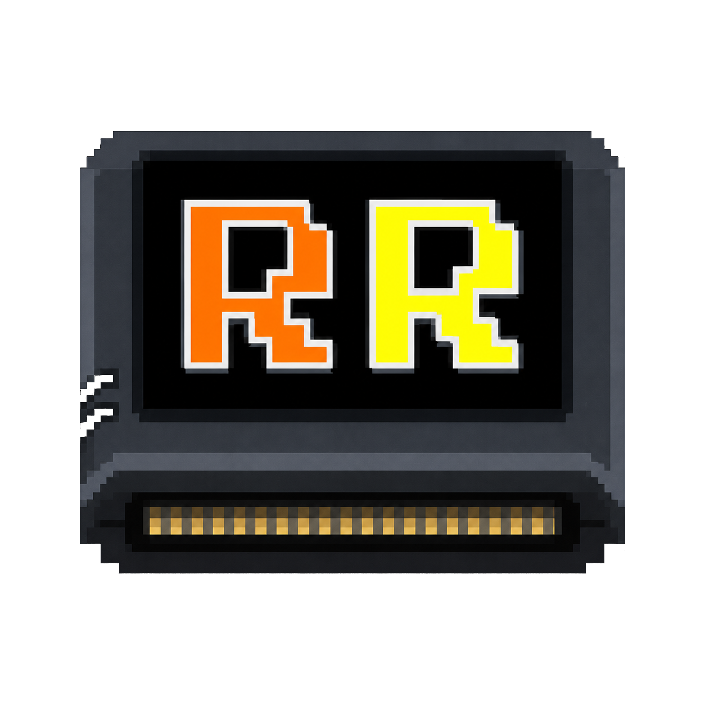

# RetroRun

  

RetroRun is a lightweight libretro frontend for Linux handhelds and macOS.
It supports software and OpenGL/OpenGL ES cores, save states, an on-screen
menu, RetroAchievements and screen decorations.

## Version 3.2.3

- Add native RG ARC-D controls, game/menu rotation and on-screen message positioning.
- Fix OpenAL audio buffer reuse during save-state loading and menu transitions.
- Improve Linux SDL2 package builds and controller database overrides.
- Preserve RG351V hotkeys across different SDL controller layouts.
- Document UnofficialOS integration tested on RG353M.

See [changelog.txt](changelog.txt) for release history.

## Backends

| Target | Backend | Output |
| --- | --- | --- |
| Supported Linux handhelds | Native GO2/DRM | `retrorun` |
| Linux handhelds and desktops | SDL2 + OpenGL ES | `retrorun-sdl2` |
| macOS | SDL2 + Desktop OpenGL | `retrorun` |

The native backend supports Anbernic RG351M, RG351P, RG351V, RG351MP,
RG552, RG503, RG353M, RG353V and RG ARC-D, plus Miniloong Pocket 1.
SDL2 compatibility depends on the device and distribution.

## Documentation

- [Building](doc/BUILDING.md): dependencies, GO2, SDL2, hybrid and macOS builds.
- [Running](doc/RUNNING.md): launch options, cores and Flycast game profiles.
- [ZIP game content](docs/zip-content.md): temporary extraction, memory use and archive limitations.
- [Configuration](doc/CONFIGURATION.md): config files and frontend settings.
- [Core options](doc/CORE_OPTIONS.md): libretro configuration examples.
- [Controls and button remapping](doc/CONTROLS.md): keyboard, shortcuts and custom mappings.
- [Features and menu](doc/FEATURES.md): frontend functions and on-screen interface.
- [Audio and benchmarking](doc/AUDIO.md): providers, buffering and test settings.
- [RetroAchievements](doc/RETROACHIEVEMENTS.md): login and achievement settings.
- [Screen decorations](doc/DECORATIONS.md): bezels, viewports and downloads.
- [UnofficialOS on RG353M](doc/UNOFFICIALOS_RG353M.md): integration and tested hardware.
- [Porting](PORTING.md): backend API, source layout and current limitations.
- [Credits](doc/CREDITS.md): contributors, libraries and artwork attribution.

### OSD themes

Classic remains the default OSD. Set `retrorun_osd_theme = retrorun` for the
optional RetroRun OS palette. See [OSD theme configuration and renderer notes](docs/osd-themes.md).
