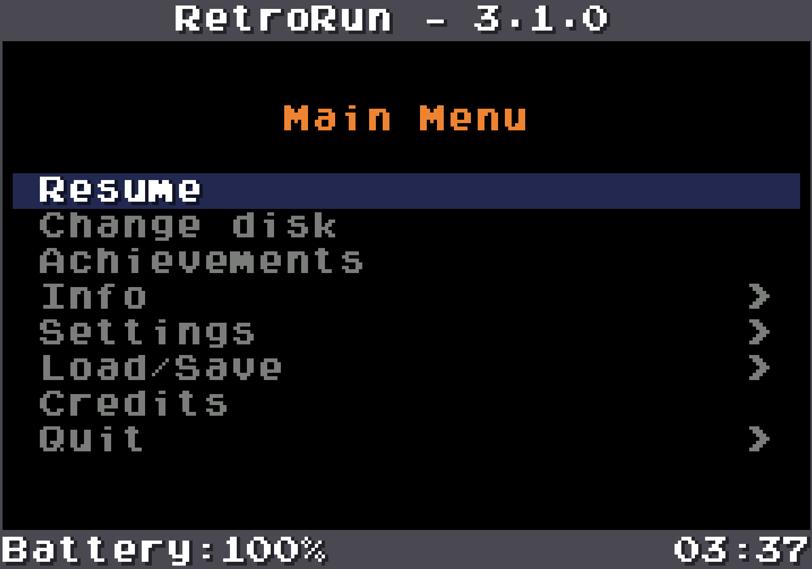

# Features and on-screen menu

[Back to README](../README.md)

## Highlights

- **Save states:** create and load states from the on-screen menu or controller
  shortcuts, choose between multiple slots, and optionally save and restore a
  state automatically when starting or closing a game.
- **Multi-disc games:** change the active CD, GD-ROM or other removable image
  while playing, using RetroRun's file browser and the libretro disk-control
  interface exposed by compatible cores.
- **Bezels and screen decorations:** automatically reuse installed AmberELEC
  and ArkOS bezel packs, select artwork per game or system, honour custom
  libretro and Batocera-style viewports, or download and manage a curated set
  directly from the menu. Alpha-composited artwork is cached and accelerated
  by RGA on supported GO2 devices.
- **RetroAchievements:** sign in from the frontend, identify supported games,
  browse locked and unlocked achievements with their badges, and display game
  identification and unlock notifications. Official achievements, optional
  unofficial achievements and Encore mode are supported in softcore mode, and
  the integration can be disabled.
- **Complete on-screen interface:** pause and resume games, inspect device,
  core, graphics and network information, change runtime video, audio, volume
  and brightness settings, manage save states and exit cleanly without leaving
  the frontend.
- **Fast-forward and frame control:** uncapped fast-forward with configurable
  frame presentation, optional adaptive or fixed frameskip, VSync and frontend
  frame pacing.
- **Flexible video output:** software and OpenGL/OpenGL ES cores, automatic or
  selectable aspect ratios, pixel-perfect scaling, Tate rotation, nearest or
  linear filtering, scanlines, CRT effects and optional screen decorations.
- **Handheld-oriented input:** controller remapping, analog-to-D-pad modes,
  Tate-aware directional controls, analog sticks, triggers, rumble and
  configurable controller shortcuts.
- **Useful frontend tools:** screenshots, an unrestricted FPS counter,
  a startup loading screen, icon-and-text notifications and an on-screen
  keyboard with upper- and lowercase input.
- **Portable backends:** native GO2/DRM support for compatible Anbernic devices
  and an SDL2 backend for Linux handhelds, Linux desktops and macOS.
- **Configurable cores and diagnostics:** per-core libretro options, separate
  frontend and core log levels, timestamped logs and selectable save, system
  and screenshot directories.

The native backend remains available for the RG351 M/P/V/MP, RG552, RG503,
RG353M, RG353V and Miniloong Pocket 1. The Pocket 1's portrait DRM panel is
rotated natively, including both Tate directions and direct scanout. The SDL2 backend provides an alternative implementation for
Linux handheld distributions such as AmberELEC, ArkOS/dArkOS and other devices
that provide SDL2, KMSDRM and OpenGL ES 3.

The Linux SDL2 backend must still be tested on each physical device. Controller
mapping, screen rotation, audio driver and performance can vary between models
and distributions.

- [Changelog](../changelog.txt)
- [Porting guide](../PORTING.md)

## On-screen menu

RetroRun includes an OSD menu shared by the native GO2/DRM and SDL2 backends.
It can pause and resume the active core and provides access to device, core and
game information, runtime settings, save states, credits and clean shutdown.
Each menu remembers its selected item when entering a submenu and returning.
The read-only **Info > Graphics** page reports the active platform backend,
renderer, software or hardware core path, output and core resolutions, pixel
format, aspect ratio, filter, shader, VSync, pixel-perfect state and UI profile.
On native DRM builds, **Info > DRM diagnostics** reports the selected direct
scanout policy, DRM driver and panel mode, connector/CRTC and plane identifiers,
plane format and rotation support, page-flip fallback state, direct-scanout
result and sampled VBlank latency/failures. These values make it easier to
compare device-specific DRM behaviour without enabling permanent debug timing.
Pressing A from this page opens a confirmation prompt for a three-second test
on the running game. During the test RetroRun temporarily forces direct scanout,
suppresses frontend/game input and overlays, then restores the previous state
and reopens the diagnostics page; the configured policy is not changed.
The default controller shortcut is L3 + R3; alternative Select/F2 shortcuts
can be enabled with `retrorun_alternative_input_mode`.

The menu uses clipped, time-based text scrolling for labels wider than the
available area. Its UI profile can be changed under **Settings > Video**:

- `auto` keeps the original compact layout on recognized Anbernic devices and
  selects the responsive desktop layout on macOS, Windows and regular Linux PCs;
- `handheld` always uses the original 240x160 menu canvas;
- `desktop` derives the menu canvas from the window size so that text remains
  approximately 16 pixels high instead of being enlarged with the game image.

  

